<div align="center">


# brain.md

**A local-first second brain for you, and for your AI agents.**

[](LICENSE)
[](https://bun.com)
[](docs/mcp.md)
[](#semantic-search-rag)
[](https://glama.ai/mcp/servers/mi4uu/brain.md)

</div>

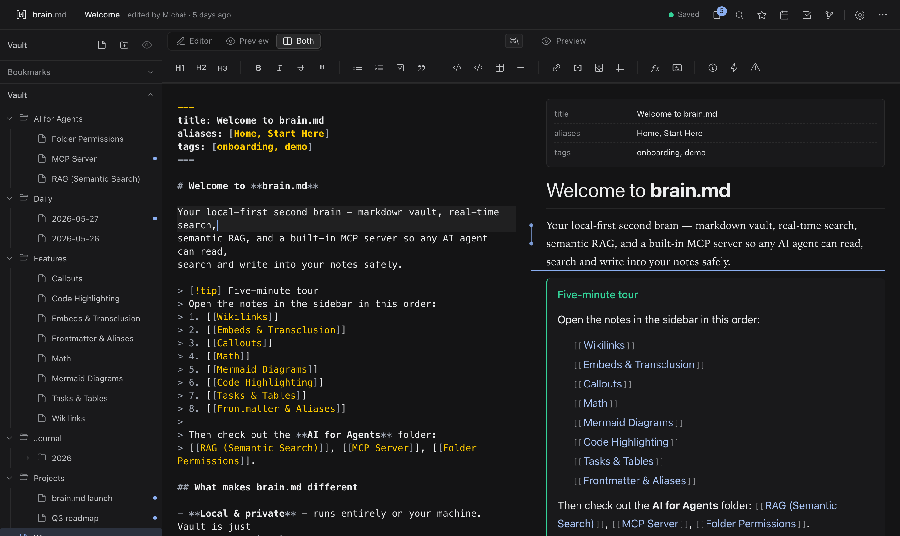

<div align="center">

### What you get

</div>

| | |
|---|---|
| **Obsidian-compatible markdown** | Wikilinks, embeds, callouts, math, mermaid, tasks, frontmatter, aliases. Open your existing Obsidian vault and it just works. |
| **Graph view** | Interactive map of your notes and wikilinks: hover to light up neighbours, click to open, drag, zoom, filter by folder or tag, plus a local graph of the current note. Smooth on thousands of notes. |
| **Live editor + preview** | CodeMirror 6 with cursor-anchored scroll sync, autosave, instant tooltips, command palette, quick switcher. Editor, Preview or Both, one click or **⌘\\**. |
| **Semantic search built in** | Per-vault embedded vector store (pure JS, no external DB). Notes are chunked, embedded and indexed on every save. |
| **Pluggable embedders** | Default: `bge-small-en-v1.5` running locally via **bundled WASM ONNX**, works in the prebuilt single binary, zero native deps. Or point at **Ollama**, **LM Studio**, or **OpenAI**: anything with `/v1/embeddings`. |
| **MCP server (streamable HTTP)** | 19 tools and 2 resources mounted on the same port. Claude Desktop, Claude Code, Cursor and any MCP-compliant agent can read, search, query and write your notes. List tools return pages, so a small local model never gets the whole vault in one reply. |
| **MCP Apps note view** | In hosts that support MCP Apps (tested with OpenClaw), `read_note` opens an interactive view of the note: clickable wikilinks, Back, backlinks, light and dark. Other clients get the same text as before. |
| **Per-folder agent permissions** | Right-click a folder → set `{read, write}` for the MCP surface. Keep `Journal/Private/` out of agent reach without locking down the vault. |
| **Optional password auth** | argon2id, bearer tokens, 24-hour TTL, gates both HTTP API and MCP. Off by default, on with one click. |
| **Git autocommit with a full audit trail** | Every save lands in git, attributed to whoever (or whichever agent) made it. Full history with author filter, diff, restore, manual checkpoints. The vault is a real git repo on disk. |
| **See what agents changed** | A Changes view lists every note an agent touched since you last looked, grouped by day, with the diff and a revert: undo just that change, or put the note back to how it was. |
| **Agents that don't overwrite each other** | `write_note` takes the revision an agent read; if another agent changed the note meanwhile, nothing is written and the agent is told to re-read and merge. |
| **A tidy tree** | Hide agent scratch files and templates from the tree and search, sort each folder its own way, daily notes grouped by year and month, a homepage note. |
| **No vendor lock-in** | Your vault is a folder of `.md` files. Open it in VSCode, Obsidian, `cat`, anything. brain.md is just one more way to view and query it. |
| **Zero API keys required** | Out of the box it runs fully offline. Cloud embedders are an opt-in, not a default. |

---

## Why brain.md

LLMs are only as smart as the context you give them. **brain.md** turns
your notes into that context, without dragging them into someone
else's cloud, without locking them inside a proprietary format, and
without asking you to plumb a vector database yourself.

You write markdown. brain.md gives you:

- a polished **editor + live preview** with the full
  Obsidian-flavor dialect (wikilinks, embeds, callouts, math, mermaid,
  highlights, tasks, frontmatter, aliases),
- a per-vault embedded vector store (pure JS, ships in the single
  binary) with a local `bge-small-en-v1.5` embedder by default
  running via bundled WASM ONNX. Switch to **Ollama**,
  **LM Studio**, **OpenAI**, or anything else with a `/v1/embeddings`
  endpoint with one toggle,
- an **MCP server** (streamable HTTP) mounted on the same port, so
  Claude Desktop (or any MCP client) can read, search and write your
  notes safely, with **per-folder read/write permissions** for the
  agent surface,
- optional **password auth** (or login via Google, GitHub, Keycloak or
  Authentik) and **git autocommit / restore** with a per-path audit
  trail for the whole vault.

Everything runs on your machine. The vault is a plain folder of `.md`
files you can open in any editor at any time.

### How it compares

|                                         | Obsidian                | Logseq          | Notion             | **brain.md**           |
|-----------------------------------------|-------------------------|-----------------|--------------------|------------------------|
| License                                 | Proprietary             | AGPL-3.0        | Proprietary        | **AGPL-3.0**           |
| Local-first vault on disk               | ✓                       | ✓               | ✗ (cloud)          | **✓**                  |
| Plain `.md` files (no proprietary db)   | ✓                       | ✓ (block model) | ✗                  | **✓**                  |
| Built-in MCP server                     | ✗ (3rd-party plugin)    | ✗               | ✗                  | **✓ (19 tools)**       |
| Vector RAG built-in                     | ✗ (paid plugin)         | ✗               | ✓ (cloud only)     | **✓ (embedded, local)** |
| Per-folder agent permissions            | n/a                     | n/a             | n/a                | **✓**                  |
| Single binary, no Electron              | ✗ (Electron)            | ✗ (Electron)    | n/a                | **✓ (`bun --compile`)** |
| Works fully offline (incl. embeddings)  | ✓ (no AI)               | ✓ (no AI)       | ✗                  | **✓ (bundled WASM ONNX)** |

brain.md is *not* trying to replace Obsidian's plugin ecosystem or
Notion's databases. It's narrower on purpose: a markdown vault
designed from day one as a memory layer for AI agents over the
Model Context Protocol.

---

## Table of contents

- [Quick start](#quick-start)
- [Install](#install)
- [The interface](#the-interface)
  - [Editor + preview](#editor--preview)
  - [Markdown that actually does things](#markdown-that-actually-does-things)
  - [Command palette + quick switcher](#command-palette--quick-switcher)
  - [Tasks across the vault](#tasks-across-the-vault)
  - [Graph view](#graph-view)
  - [Keeping the vault tidy](#keeping-the-vault-tidy)
  - [Auto versioning & history](#auto-versioning--history)
  - [What agents changed](#what-agents-changed)
  - [Mobile](#mobile)
- [AI for agents](#ai-for-agents)
  - [Semantic search (RAG)](#semantic-search-rag)
  - [MCP server](#mcp-server)
  - [MCP Apps: notes as an interactive view](#mcp-apps-notes-as-an-interactive-view)
  - [Per-folder permissions](#per-folder-permissions)
  - [Optional password auth](#optional-password-auth)
  - [Login with Google, GitHub, Keycloak or Authentik](#login-with-google-github-keycloak-or-authentik)
  - [Audit trail](#audit-trail)
- [CLI](#cli)
- [Defaults & paths](#defaults--paths)
- [Architecture](#architecture)
- [Roadmap](#roadmap)
- [Contributing](#contributing)
- [License](#license)

---

## Quick start

One line, no clone, no Bun, no Node: the installer detects your OS and
arch, downloads the matching prebuilt binary from the latest GitHub
release, drops it in `~/.local/bin` (or `%USERPROFILE%\.brain.md\bin`
on Windows), and verifies it runs.

### macOS / Linux

```sh
curl -fsSL https://raw.githubusercontent.com/mi4uu/brain.md/main/install.sh | bash
```

### Windows (PowerShell)

```powershell
powershell -c "irm https://raw.githubusercontent.com/mi4uu/brain.md/main/install.ps1 | iex"
```

Then:

```sh
brainmd                  # serve on :3000, vault at $HOME/.local/share/brain.md/vault
open http://localhost:3000
```

Open <http://localhost:3000>. First run creates your vault at the
XDG default (`$HOME/.local/share/brain.md/vault` on macOS / Linux,
the equivalent on Windows).

To enable semantic search and the MCP `similar_notes` tool, open
**Settings → AI / RAG** and flip the switch. Default embedder is
`bge-small-en-v1.5` running locally via bundled WASM ONNX (one-time
~34 MB quantized model download, then fully offline, no Ollama, no
Python, no native deps).

> **Want a tour?** Point brain.md at the demo vault that ships with
> the repo:
> ```sh
> brainmd --vault-dir ./example/vault
> ```
> Every screenshot below was taken against [`example/vault/`](example/).

---

## Install

### Option A: install script *(recommended, see [Quick start](#quick-start))*

```sh
# macOS / Linux
curl -fsSL https://raw.githubusercontent.com/mi4uu/brain.md/main/install.sh | bash

# Windows
powershell -c "irm https://raw.githubusercontent.com/mi4uu/brain.md/main/install.ps1 | iex"
```

The script picks the right asset for your OS and CPU, downloads it
together with the release's `SHA256SUMS`, verifies the checksum
matches before installing anything, writes the binary to
`~/.local/bin/brain` (or `%USERPROFILE%\.brain.md\bin\brain.exe`),
chmod's it, and verifies it boots. Pin a version with
`BRAIN_VERSION=v0.1.0`, change the install dir with `BRAIN_INSTALL=…`.

### Option B: download the binary manually

Every release ships a **single-file executable** per platform with
the web UI embedded inside it, plus a `SHA256SUMS` file to verify them
against. No Bun runtime, no Node.js, no `git clone`, no `bun install`.
Just download, mark executable, run.

Grab the file for your machine from the latest release:
**[github.com/mi4uu/brain.md/releases/latest](https://github.com/mi4uu/brain.md/releases/latest)**

| Platform                          | Architecture | Asset                                                                                                          |
|-----------------------------------|--------------|----------------------------------------------------------------------------------------------------------------|
| macOS (Apple Silicon)  | `arm64`      | [`brain-md-darwin-arm64`](https://github.com/mi4uu/brain.md/releases/latest/download/brain-md-darwin-arm64)    |
| macOS (Intel)          | `x64`        | [`brain-md-darwin-x64`](https://github.com/mi4uu/brain.md/releases/latest/download/brain-md-darwin-x64)        |
| Linux                   | `x64`        | [`brain-md-linux-x64`](https://github.com/mi4uu/brain.md/releases/latest/download/brain-md-linux-x64)          |
| Linux                   | `arm64`      | [`brain-md-linux-arm64`](https://github.com/mi4uu/brain.md/releases/latest/download/brain-md-linux-arm64)      |
| Windows                  | `x64`        | [`brain-md-windows-x64.exe`](https://github.com/mi4uu/brain.md/releases/latest/download/brain-md-windows-x64.exe) |

#### One-liner: macOS / Linux

```sh
# macOS Apple Silicon: swap the URL suffix for your platform from the table above
curl -L -o brainmd \
  https://github.com/mi4uu/brain.md/releases/latest/download/brain-md-darwin-arm64
chmod +x brainmd
./brainmd                                # → serves on http://localhost:3000
```

```sh
# Optional: drop it on your $PATH so you can run `brainmd` anywhere
sudo mv brainmd /usr/local/bin/brainmd
brainmd --help                           # see all flags
brainmd --port 4000                      # custom port
brainmd --vault-dir ~/notes/my-vault     # custom vault location
```

#### One-liner: Windows (PowerShell)

```powershell
iwr https://github.com/mi4uu/brain.md/releases/latest/download/brain-md-windows-x64.exe `
    -OutFile brainmd.exe
.\brainmd.exe                            # → serves on http://localhost:3000
.\brainmd.exe --help                     # all flags
```

> **First run:** brain.md creates an empty vault at the XDG default
> (`$HOME/.local/share/brain.md/vault` on macOS/Linux, the equivalent
> on Windows) and serves the editor at <http://localhost:3000>.
> Want to try the demo vault first? Download
> [`example/vault/`](example/) and pass it with
> `brain --vault-dir ./vault`.

> Untagged commits also produce binaries; they live as build
> artifacts on the [Actions page](https://github.com/mi4uu/brain.md/actions)
> with 30-day retention.

### Option C: from source

```sh
git clone https://github.com/mi4uu/brain.md.git
cd brain.md
bun install
bun run start            # runs the production server on :3000
```

For development:

```sh
bun run dev:server       # backend on :3000
bun run dev:web          # vite on :5173 (with /api proxy)
```

If you run `bun run start` from a fresh source checkout (no compiled
binary, no `web/dist`), the server downloads the matching web bundle
from the GitHub release into
`$XDG_CACHE_HOME/brain.md/web/<version>/` on first request and serves
from there. To always work offline, run `bun run --cwd web build`
once.

> Requires [Bun ≥ 1.3](https://bun.com). brain.md uses `Bun.password`
> (built-in argon2id) so you don't need a native crypto build.

---

## The interface

### Editor + preview

Two synchronised panes powered by **CodeMirror 6** and a
**unified / remark / rehype** rendering pipeline. The active block
in the preview stays anchored to the cursor in the editor; a thin SVG
connector marks the link between them.

Need more room? The **Editor / Preview / Both** switch in the pane
header picks the layout in one click, and **⌘\\ / Ctrl+\\** cycles
through the three. The choice is remembered per device.

The chip at the top right says where your text is: *Unsaved* while you
type, *Saving*, *Saved*, then *Saved, not in history* until the
autocommit picks it up. Click it to record the change in history right
away, retry a failed save, or open History.

**Tables.** Pipe tables are edited visually or from the keyboard and always
stay plain Markdown. In the editor, <kbd>Tab</kbd> / <kbd>Shift-Tab</kbd> move
between cells and re-pad the table, <kbd>Enter</kbd> moves down (and adds a
row at the end), <kbd>Shift-Enter</kbd> then <kbd>Enter</kbd> leaves it with
a blank line, <kbd>Mod</kbd>+<kbd>Alt</kbd>+<kbd>T</kbd> formats it. In the
preview, click a cell to edit it, use the `+` on the right and bottom edge to
add a column or row, drag the grips to reorder, and right click for insert,
delete, move and align. Each preview edit is one undo step in the editor;
with the preview alone on screen, switch to the editor to undo. On a phone,
tap a cell for the action bar. On iPhone the long-press menu may not open on
the first press; the tap action bar has every action. A literal pipe inside a cell, including inside code or a
`[[link|alias]]`, must be written `\|`, as GFM requires.

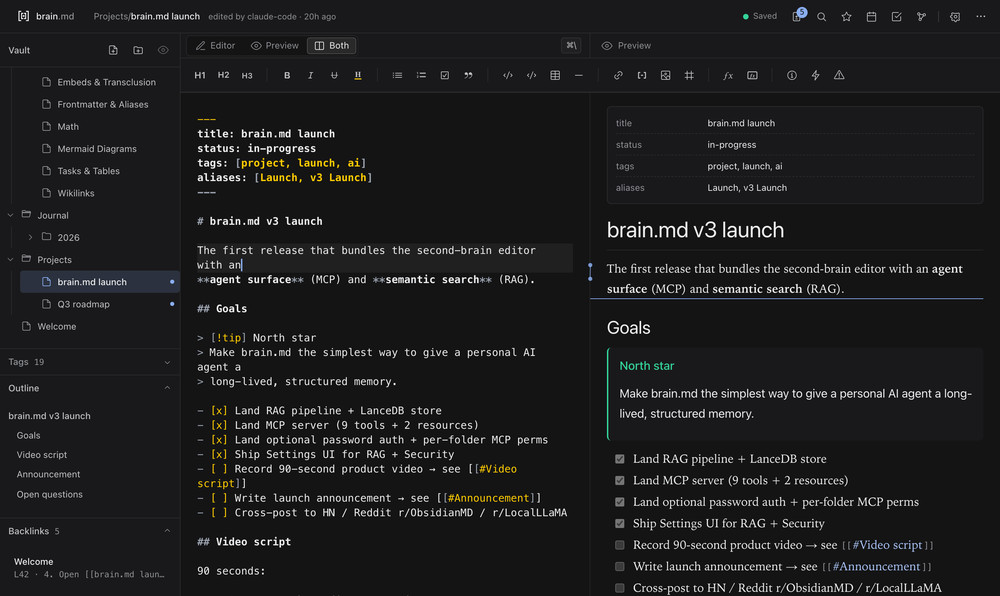

The right rail collects **Bookmarks · Vault · Tags · Outline ·
Backlinks · Related**. Each section is collapsible and remembers its
state per device (`localStorage`). The **Tags** panel splits into
*In this note* and *Other tags* the moment you open a note. The
**Related** panel powers itself from the RAG index, the same engine the
agents use, and after every save brain.md quietly suggests up to three
tags borrowed from your closest semantic neighbours.

The accent colour is yours to pick: **Settings → Editor → Accent** has
Ink, Violet, Teal, Rust and Graphite, each tuned for light and dark.
It marks the selection, the active block and the new-change dots, and
nothing else.

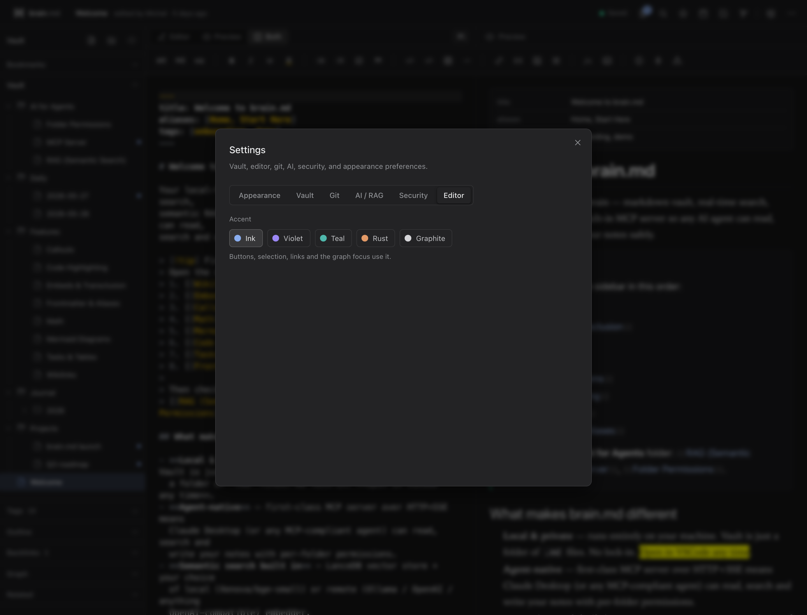

### Markdown that actually does things

#### Callouts

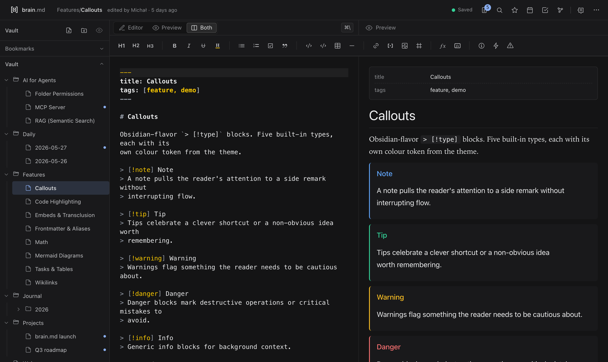

#### Math (KaTeX)

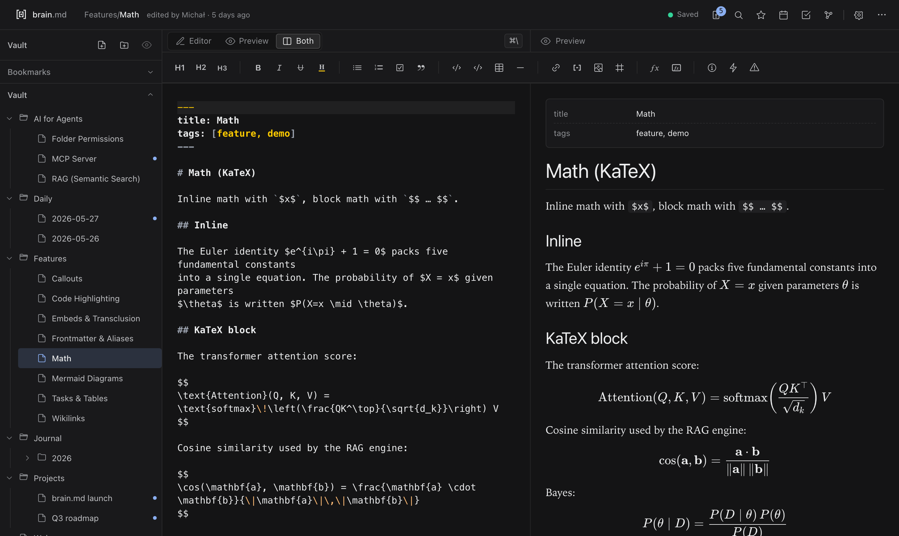

#### Mermaid diagrams

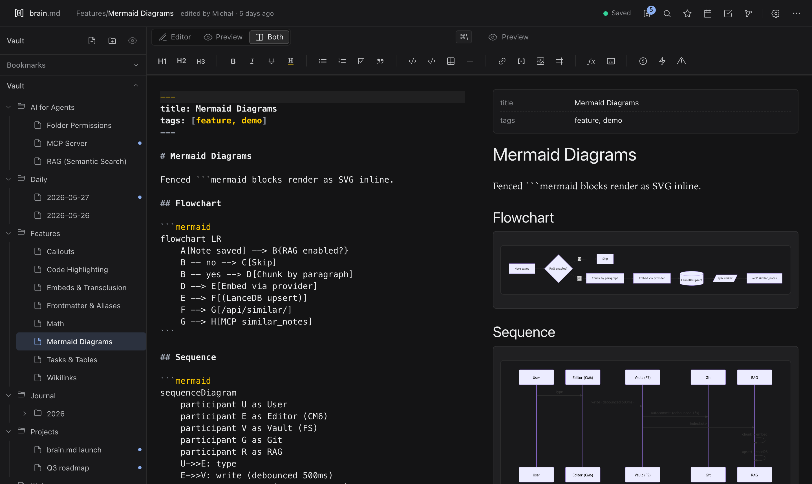

#### Syntax-highlighted code

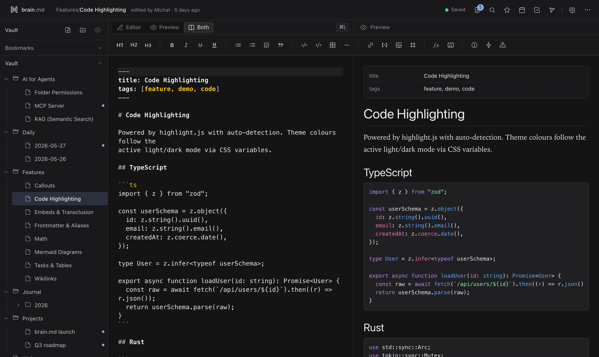

### Command palette + quick switcher

- **⌘P / Ctrl+P**: search across titles and bodies
- **⌘O / Ctrl+O**: fuzzy quick switcher

Both are powered by [cmdk](https://cmdk.paco.me) inside a Radix Dialog.

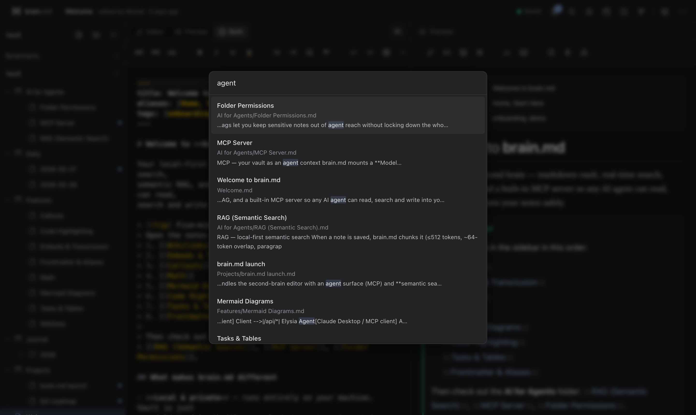

### Tasks across the vault

Every `- [ ]` and `- [x]` in your notes is collected into a single
view, with filters for open / done / all and a click-through to the
source line.

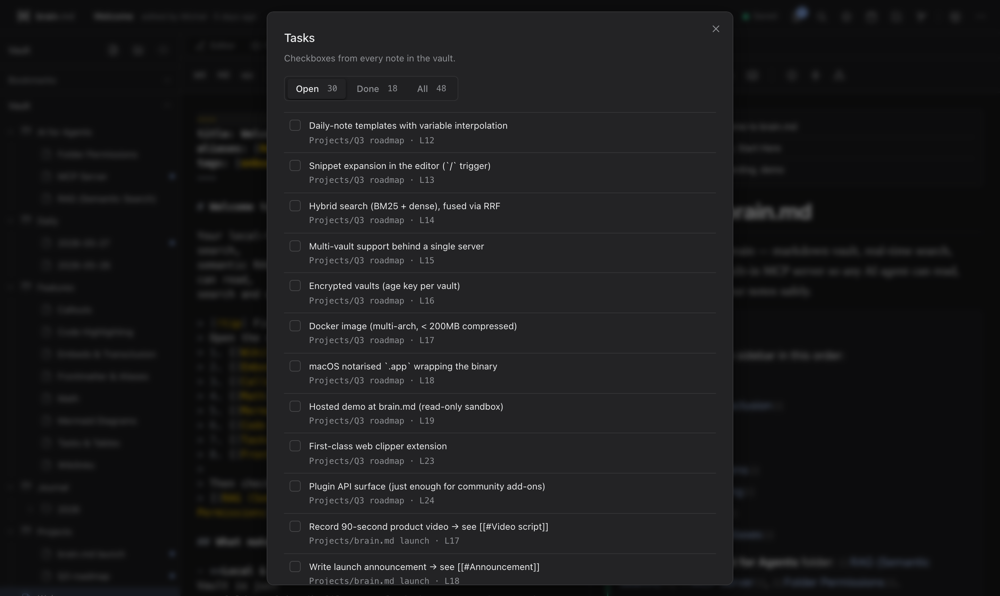

### Graph view

Your notes as a map: every note is a dot, every wikilink a line, coloured
by top-level folder. Open it from the graph button in the toolbar.

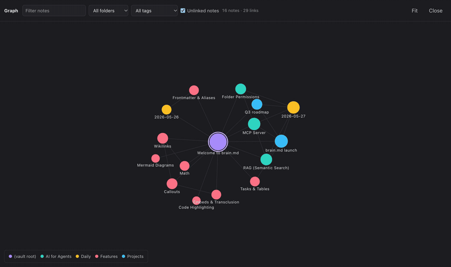

- **Hover** a note to light up its links and neighbours; **click** to open it.
- **Drag** notes around, **pan** by dragging the background, **zoom** with
  the wheel or a pinch. Works with touch on a phone.
- **Filter** by folder, tag or name, and hide notes without links.
- **Local graph** in the sidebar: the current note and its neighbours,
  one or two hops out, with a jump to the full graph.
- Light and dark follow the app theme.
- Folder permissions apply: a note in a folder you can't read is not in
  the graph, and neither are links to it.

It stays smooth on big vaults. On a generated 3,000-note vault
(`bun scripts/gen-demo-vault.ts <dir> 3000`) the layout settles in under
2 seconds and dragging runs at about 90 fps on a laptop.

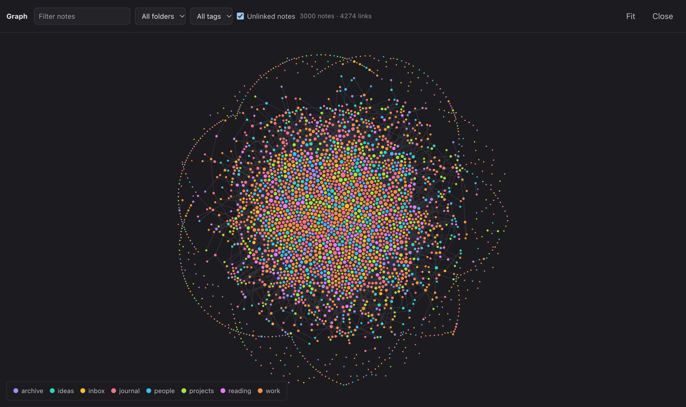

### Keeping the vault tidy

Agents leave working files behind (inboxes, phone logs, templates). Keep
them out of the way without moving them:

- **Hidden notes.** Settings, Vault: one glob per line (`Journal/telefon.md`,
  `**/_*`, `Archive/**`), or right-click a note or folder, **Hide**. A note
  can also hide itself with `hidden: true` in its frontmatter, or stay in
  the tree but out of search with `search: false`. Hidden notes leave the
  tree, search, the graph and semantic search; the eye in the sidebar
  header shows them again, dimmed. Agents still read and write them by
  path.
- **Sort per folder.** Right-click a folder: name A to Z or Z to A, recently
  changed first or oldest first. Stored in the vault, so it travels with it.
- **Daily notes by year and month.** Notes named `YYYY-MM-DD` in the daily
  notes folder show up grouped by year and month, newest first. The files
  stay where they are.
- **Homepage.** Right-click a note, **Set as homepage** (or Settings,
  Vault). It opens whenever the app starts without a note in the URL.
- **Bookmarks** follow their note when it is renamed and go away when it
  is deleted; one left pointing nowhere is struck through, with an ×.
- **Links to missing notes** ask before creating anything, so a typo in a
  `[[link]]` doesn't leave an empty file behind.

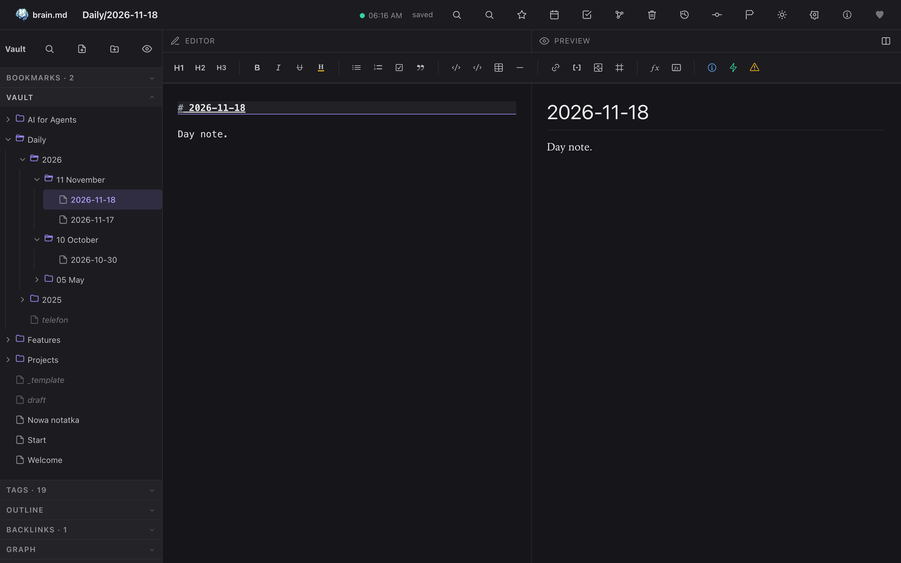

### Auto versioning & history

Every save is auto-committed to git in the background (debounced,
~15 s). Open any note's **History** panel to see every prior
revision, who made it (a person or which agent), side-by-side unified
diffs, and a one-click **Restore this version**. Filter by the current
note or by the whole vault, and by author.
No "save as", no daily snapshots cron: the vault is a real git
repo on disk, so `git log`, `git blame`, `git diff` all work from
the terminal too.

A restore only touches the one file you asked for and commits only
that path, never a sweep of whatever else happened to be dirty in the
vault at the time. See [Audit trail](#audit-trail) for who a commit
is attributed to when more than one person or agent wrote to the vault
in the same save window.

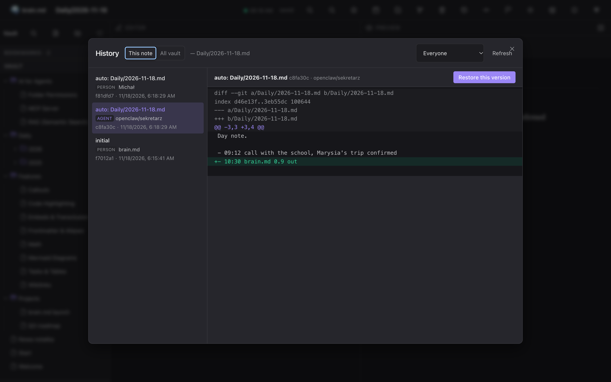

### What agents changed

History answers "what happened to this note". **Changes** answers "what
did my agents do while I was away". It opens on its own when there is
something new, and it sits behind the button with the badge in the
topbar the rest of the time.

- Notes are grouped by day, newest first, one row per note with who
  touched it and when. Notes you have not looked at yet carry a dot,
  in the list and in the file tree.
- *Only agents* hides your own edits. *Mark all seen* moves your
  cursor to now. The cursor is stored on the server, so a second
  browser or your phone agrees on what is new.
- Expand a note to see each edit with its diff.

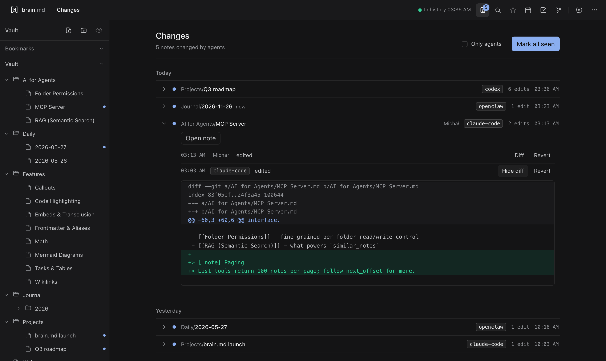

Every edit has a revert, and the dialog tells you what goes with it.
**Undo only this change** takes out that one edit and keeps everything
written after it. **Restore the note to before this change** puts the
note back to that point and lists the later edits that go too. A note
an agent created moves to Trash instead. If the note changed in a way
that conflicts, nothing is written and you are told why.

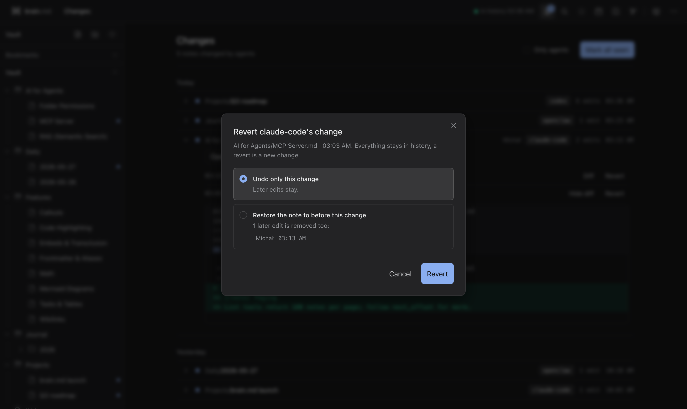

### Mobile

brain.md is not a desktop-only tool. The same vault, the same
self-hosted instance, the same editor work from your phone too, over
LAN, Tailscale, or a **Cloudflare Tunnel** (Zero Trust, no public
port, no DDNS). The server itself is tiny, a single Bun binary
that runs comfortably on the free tier of **Oracle Cloud** or
**AWS** (ARM micro instances, ≤1 vCPU / ≤1 GB RAM). Drop the binary
on a $0/month VPS, route a hostname to it through Cloudflare, and
you have a private second brain reachable from any device, anywhere.

Without a password the server only accepts requests whose `Host`
header is `localhost`/`127.0.0.1`/`[::1]` or an entry in
`ALLOWED_HOSTS`, as a guard against DNS rebinding. Set a password
(you want one anyway outside loopback) or add your LAN name or tunnel
hostname to `ALLOWED_HOSTS`. With a password set the check is off.

Behind a tunnel or reverse proxy, the login and OAuth-consent rate
limiter keys on the real TCP peer by default, which is the tunnel
itself (loopback), not the actual client: every request shares one
bucket. Set `BRAINMD_TRUST_PROXY=cloudflare` when a Cloudflare Tunnel
(`cloudflared`) runs on the same host and forwards to a local port,
to key on the `CF-Connecting-IP` header Cloudflare's edge sets
instead, only honoured when the direct peer is loopback. For any
other local reverse proxy, set `BRAINMD_TRUST_PROXY` to a
comma-separated list of its IPs to key on `X-Forwarded-For` instead
(the right-most entry that isn't itself one of those IPs), only
honoured when the direct peer is one of them. Leave it unset if
there's no local proxy in front of the server at all.

The mobile layout adapts: editor and preview swap in place via a
bottom tab, the topbar scrolls horizontally with a sticky brand +
hamburger, the sidebar slides in as a drawer.

<p align="center">
  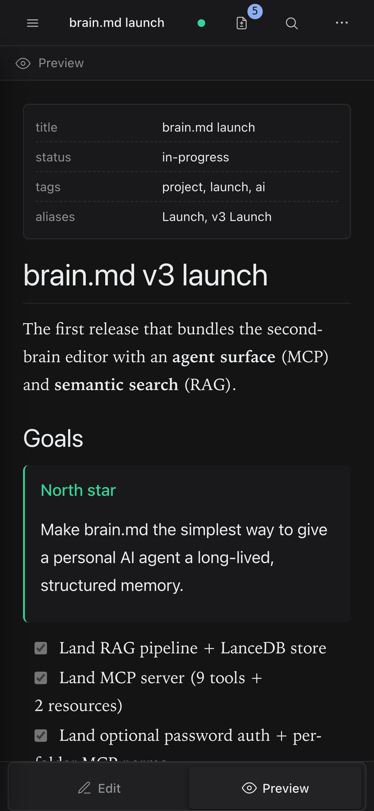
  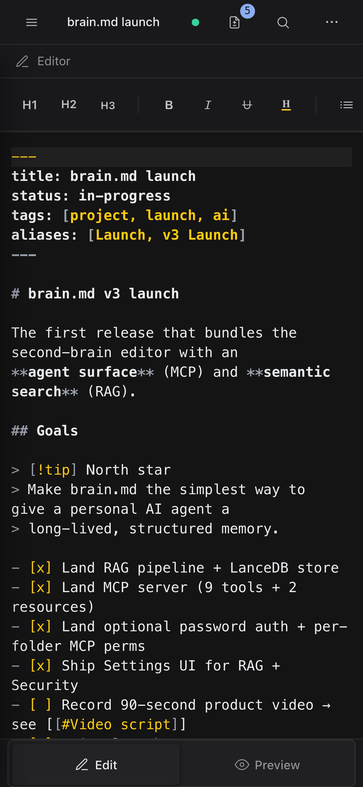
  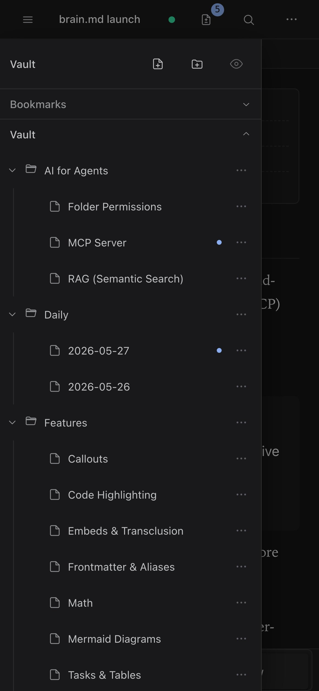
</p>

A phone is a first-class client, not a squeezed desktop: touch-sized
rows and buttons, row actions always in reach, and the same RAG, tags,
backlinks, tasks and Changes view you have on desktop.

---

## AI for agents

This is what makes brain.md more than another markdown editor.

### Semantic search (RAG)

When a note is saved, brain.md chunks it (≤ 512 tokens, ~64-token
overlap, paragraph-aligned, frontmatter excluded), embeds each chunk,
and upserts the vectors into a per-vault embedded store at
`<VAULT>/.brain/vectors.json` (pure JS, brute-force cosine, well
under 10ms for typical vaults).

The store follows the disk. Notes deleted, moved or edited outside
brain.md (`mv`, `git pull`, a sync tool, another agent) are picked up at
startup and by a sync every 60 seconds. A search hit whose note no
longer exists is dropped and its vectors deleted on the spot, so a
deleted note never comes back through semantic search.

| Provider                | Model                                       | dim   | Local? | API key |
|-------------------------|---------------------------------------------|------:|:------:|:-------:|
| Local *(default)*       | `bge-small-en-v1.5` (WASM)                  |   384 |   ✓    |   no    |
| llama-server *(best)*   | `embeddinggemma-300m` (GGUF Q8)             |   768 |   ✓    | optional |
| Ollama                  | e.g. `nomic-embed-text`                     |   768 |   ✓    |   no    |
| LM Studio               | any served GGUF embedder                    | varies|   ✓    |   no    |
| OpenRouter *(free tier)*| `nvidia/llama-nemotron-embed-vl-1b-v2:free` |  2048 |   no    |   yes     |
| OpenAI                  | `text-embedding-3-small`                    |  1536 |   no    |   yes     |

> **Out of the box, in the prebuilt binary.** The local embedder ships
> as bundled WASM ONNX with a hand-rolled BERT tokenizer: no
> `onnxruntime-node`, no `sharp`, no platform-specific `.node`
> bindings. Toggle **Enable RAG** in Settings → AI / RAG, brain.md
> fetches the ~34 MB quantized model once and works fully offline
> after that, on macOS / Linux / Windows alike. Want to keep your
> existing Ollama or hosted endpoint? Switch to *OpenAI-compatible*
> in the same panel.

#### Best quality: EmbeddingGemma on your own llama-server

The default bge-small model is English-only and small. On a real
Polish/English vault (52 queries, see [eval/retrieval](eval/retrieval/))
it found the right note in the top results far less often than a
multilingual model:

| Embedder | nDCG@10 | Cross-language queries |
|---|---:|---:|
| bge-small (default, WASM) | 0.61 | 0.42 |
| EmbeddingGemma-300M Q8 via llama-server | **0.89** | **1.00** |

EmbeddingGemma-300M needs about 550 MB of RAM and answers a query in
about 40 ms on a 4-core laptop CPU, so a spare box on your network is
enough. On the box that will embed:

```sh
# llama.cpp release build, then the model (Q8, 334 MB)
curl -LO https://huggingface.co/ggml-org/embeddinggemma-300M-GGUF/resolve/main/embeddinggemma-300M-Q8_0.gguf
openssl rand -hex 32 > embed-key && chmod 600 embed-key
llama-server -m embeddinggemma-300M-Q8_0.gguf --embedding \
  --host <address brain.md can reach> --port 8091 \
  --api-key-file embed-key -c 4096 -ub 2048 --parallel 2
```

Then in **Settings → AI / RAG**: Provider *OpenAI-compatible*, Base URL
`http://<that address>:8091/v1`, Model `embeddinggemma-300m`, DIM `768`,
and the key. brain.md knows the model's prompts (`task: search result |
query: …` for searches, the note title plus the text for notes) and uses
them on its own. To keep the key out of the settings file, set
`BRAINMD_EMBED_API_KEY` in brain.md's environment (for example a
systemd `EnvironmentFile` with mode 600); it wins over the saved key.

EmbeddingGemma is under the [Gemma terms of use](https://ai.google.dev/gemma/terms).
If you want a licence-clean alternative, `bge-m3` (MIT, `ggml-org/bge-m3-Q8_0-GGUF`,
DIM `1024`) scored the same on dense search but is about twice as slow on CPU.

**What leaves the machine.** With any HTTP embedder, the text of every
note brain.md indexes is sent to that server: on every save, and for
the whole vault on a reindex. Searches send the query text. Notes
matching **Never send to the embedder** in the same panel (globs, one
per line, default `**/secrets/**`) are never sent; they stay out of
semantic search but keyword search still finds them, and their old
vectors are removed on the next reindex.

**When the embedder is away.** If it is down, asleep or slow (no answer
within 4 seconds), `similar_notes`, `context_for_query` and the search
API answer with keyword search instead, each hit marked
`"source": "keyword"`, and the Related panel stays empty. Notes saved
meanwhile are embedded once it is back. Changing the model, the
endpoint or the prompt templates rebuilds the index in the background;
until it is done, the same keyword fallback answers.

#### OpenRouter: free embeddings, zero local deps

If the WASM model doesn't fit your machine (constrained RAM / no
disk space for the cache) and you don't want to run Ollama either,
**OpenRouter** ships a free OpenAI-compatible embeddings endpoint
that requires no local model, no GPU, no setup beyond an API key.

In **Settings → AI / RAG**:

| Field      | Value                                       |
|------------|---------------------------------------------|
| Provider   | OpenAI-compatible                           |
| Base URL   | `https://openrouter.ai/api/v1/`             |
| Model      | `nvidia/llama-nemotron-embed-vl-1b-v2:free` |
| DIM        | `2048`                                      |
| API Key    | from [openrouter.ai/keys](https://openrouter.ai/keys), no credit card required for `:free` models |

Click **Test connection**, then **Reindex vault**. Indexes the whole
vault in seconds, multilingual, multimodal-aware (works on notes
mixing languages). Trade-offs: data leaves your machine on every
embed call; free tier has rate limits; works only when online.

> **Heads-up: the same applies to Ollama, OpenAI, or any HTTP embedder.**
> Switching `Base URL`, `API Key`, or `DIM` while staying on the same
> provider and model takes effect immediately as of v0.3.1 / v0.4.0
> ([B17](https://github.com/mi4uu/brain.md/commit/511cc69)). Older
> binaries needed a server restart for those fields to apply.

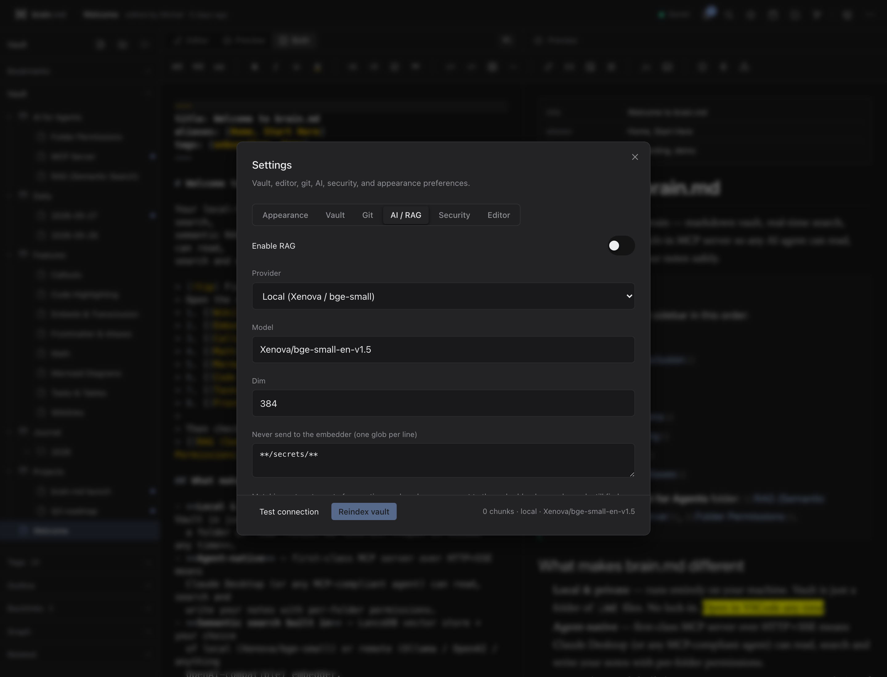

REST surface:

| Method | Path                          | What                                                   |
|--------|-------------------------------|--------------------------------------------------------|
| GET    | `/api/similar?q=…&k=…`        | Top-k semantic hits with snippet + line range          |
| GET    | `/api/related/*path?k=…`      | Notes semantically close to a given path               |
| POST   | `/api/context`                | Pack top chunks into a token-budgeted markdown block   |
| GET    | `/api/orphans?limit=…`        | Notes with no backlinks AND low semantic neighbours    |
| GET    | `/api/digest?since=7d`        | Topic clusters across recently modified notes          |
| GET    | `/api/rag/status`             | Provider, model, dim, chunks, `needsReindex`           |
| POST   | `/api/rag/reindex`            | Walks the vault and rebuilds the index                 |
| POST   | `/api/rag/test`               | Dry-run an embedder config without saving              |

#### Related notes, in the sidebar

The same engine the agents use also powers a **Related** panel in the
sidebar. Open any note → the panel lists semantically close neighbours
with score, line range and a snippet preview. Click jumps you there.

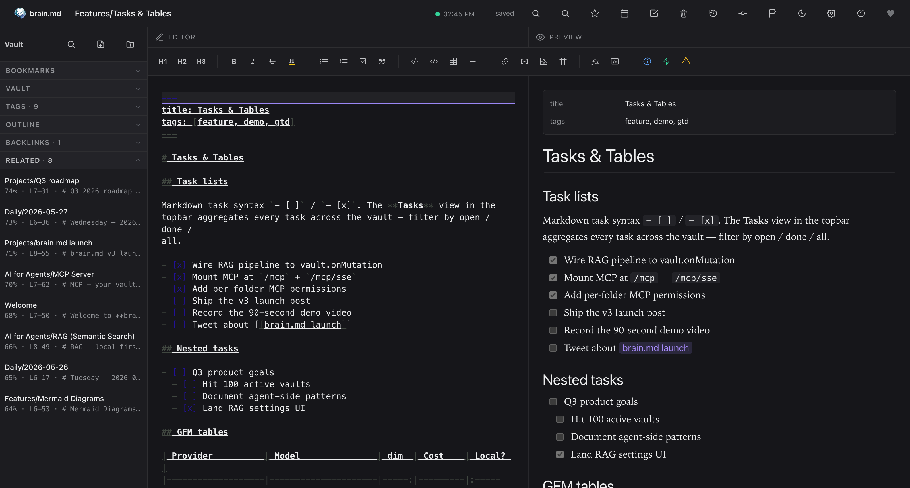

#### Tag suggestions on save

After every save, brain.md quietly looks at the closest neighbours'
frontmatter `tags` and suggests up to three you haven't used yet.
One click drops the tag into your frontmatter.

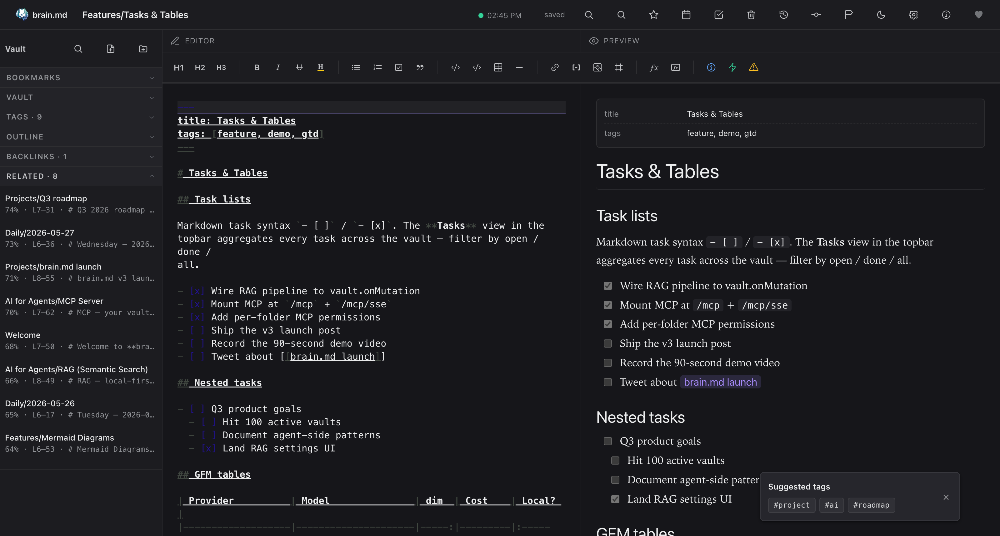

### MCP server

brain.md mounts a **Model Context Protocol** server on the same Elysia
app at `POST /mcp`. Transport is the **2024-11-05 streamable HTTP**
variant in **stateless JSON-response mode**: one POST returns the
full JSON-RPC response in a single round trip, no SSE stream, a fresh
`McpServer` and transport per request. That sounds wasteful, but it's
the only mode that survives clients that open and close a transport
per tool call. Claude Desktop and LM Studio both do this.

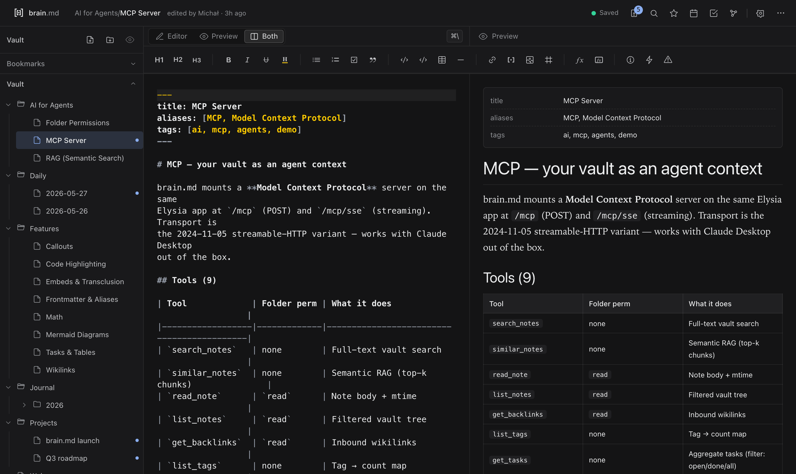

Tools (19):

| Tool                  | Folder perm | What it does                                                       |
|-----------------------|-------------|--------------------------------------------------------------------|
| `search_notes`        | `read`      | Full-text vault search                                             |
| `similar_notes`       | `read`      | Semantic RAG (top-k chunks)                                        |
| `read_note`           | `read`      | Note body, mtime, parsed `properties`                              |
| `list_notes`          | `read`      | Filtered vault tree, paged                                         |
| `get_backlinks`       | `read`      | Inbound wikilinks                                                  |
| `graph_view`          | `read`      | Graph of notes and links (whole vault, a folder, or around a note) |
| `list_tags`           | `read`      | Tags with counts, most used first, paged                           |
| `get_tasks`           | `read`      | Aggregate tasks (filter: open/done/all)                            |
| `write_note`          | `write`     | Create or overwrite a note                                         |
| `append_note`         | `write`     | Append a paragraph (blank-line separator)                          |
| `update_properties`   | `write`     | Change frontmatter properties (`set`, `unset`, `base_revision`)    |
| `find_related`        | `read`      | Notes semantically close to a given path (excludes self)           |
| `find_similar_tasks`  | `read`      | Semantic search across task lines (filter: open/done/all)          |
| `semantic_outline`    | `read`      | Cluster a note's chunks into topical groups (cosine ≥ threshold)   |
| `context_for_query`   | `read`      | Pack top-relevant chunks into a markdown context block (token cap) |
| `find_orphans`        | `read`      | Notes with 0 backlinks AND low semantic neighbour density          |
| `weekly_digest`       | `read`      | Topic clusters across notes modified in a recent window (e.g. 7d)  |
| `compare_notes`       | `read`      | Cosine sim + unified diff + shared headings between two notes      |
| `current_datetime`    | none        | Server date, time and timezone, so agents never guess "now"        |

Every tool carries MCP annotations. All of them are `readOnlyHint: true`
except `write_note` (overwrites: `destructiveHint`; not idempotent, a
repeat still bumps mtime), `append_note` (adds: neither destructive
nor idempotent) and `update_properties` (changes only the named
frontmatter keys; destructive, idempotent). Hosts with an approval mode based on annotations can run
reads without a prompt and still ask before writes. Annotations are hints
for the host; folder permissions are what brain.md enforces.

List tools page their results: `list_notes` (100 per page),
`search_notes` (20), `get_tasks`, `get_backlinks` (50 each) and
`list_tags` (100). Each takes `limit` and `offset`. When there is more,
the reply says so and gives the next `offset`, so an agent asks for the
next page instead of drowning in one huge reply. See
[docs/mcp.md](docs/mcp.md#paging).

Resources (2):

- `vault://tree`: JSON `{folders, notes}` filtered by read perms
- `vault://note/<path>`: markdown body

Drop this into the MCP config of any client that speaks **streamable
HTTP natively**: Claude Code, Cursor, Continue, Cline, Zed, the
official `@modelcontextprotocol/inspector`, and others.

```json
{
  "mcpServers": {
    "brain.md": {
      "type": "streamable-http",
      "url": "http://localhost:3000/mcp"
    }
  }
}
```

Restart the client; the tools appear.

#### Claude Desktop needs a stdio bridge

The Claude Desktop app (macOS / Windows) only speaks **stdio**.
Streamable HTTP and SSE are not supported as of writing. Bridge it
through [`mcp-remote`](https://github.com/geelen/mcp-remote), which
runs as a stdio child of Claude Desktop and forwards every JSON-RPC
call over HTTP to your brain.md server:

```json
{
  "mcpServers": {
    "brain.md": {
      "command": "npx",
      "args": [
        "mcp-remote",
        "http://localhost:3000/mcp"
      ]
    }
  }
}
```

Drop that into `~/Library/Application Support/Claude/claude_desktop_config.json`
(macOS) or the equivalent on your OS, then restart Claude Desktop.

> **Note**: `mcp-remote` upstream warns that Cursor and Claude Desktop
> (Windows) have a bug where spaces inside `args` aren't escaped. Keep
> URL and header values quote-clean, no embedded spaces.

Full reference: [docs/mcp.md](docs/mcp.md).

### MCP Apps: notes as an interactive view

In hosts that support the [MCP Apps](https://modelcontextprotocol.io/extensions/apps)
extension, `read_note` renders the note inside the chat instead of a
block of JSON. Wikilinks open the target note in place, Back returns,
backlinks are listed under the note, and the view follows the host's
light or dark theme.

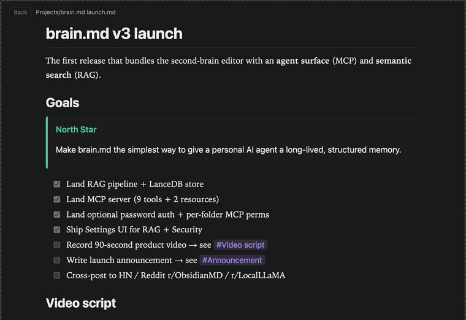

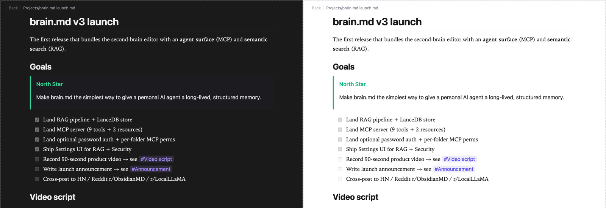

- **Hosts:** tested with OpenClaw (Control UI) and the official
  ext-apps `basic-host`. Other hosts that implement MCP Apps (Claude,
  VS Code GitHub Copilot, Goose, MCPJam) use the same protocol.
- **Nothing to configure in brain.md.** The view ships inside the binary
  as `ui://brainmd/note.html` (one self-contained HTML file, no network
  access). Clients without MCP Apps keep getting exactly the same text
  result.
- **One call per note.** `read_note` carries the backlinks and resolved
  wikilinks in its result `_meta`, filtered by the caller's folder
  permissions, so the view needs no extra tool calls. Hosts that ask you
  to approve every call from a view prompt once per note.
- **Read-only.** `write_note`, `append_note` and `update_properties` are marked model-only
  (`visibility: ["model"]`), so a spec-following host won't let the view
  call them.
- Images and other media show a placeholder in the view. Maths uses
  system fonts.

**Graph view in chat.** `graph_view` (whole vault, one folder, or the
notes around one note) shows the same interactive graph as the web app.
Click a note to centre the graph on it, Back to step out, and "Open in
chat" asks the agent to open that note. The model itself gets a short
summary: counts and the most linked notes.

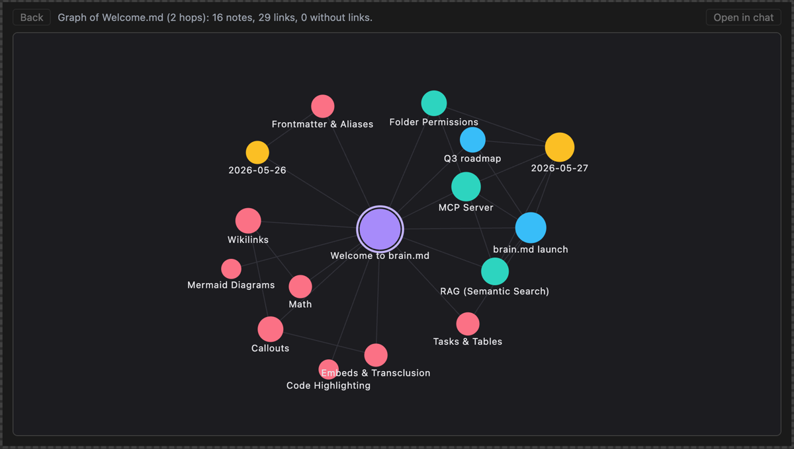

**OpenClaw:**

```bash
openclaw config set mcp.apps.enabled true --strict-json   # then restart the Gateway
openclaw mcp add brainmd --url https://your-brain.example.com/mcp --transport streamable-http
openclaw mcp configure brainmd --approval auto             # reads run without prompts, writes still ask
openclaw mcp doctor brainmd --probe
```

Then ask the agent to read a note, e.g. "open my Welcome note from
brainmd". If the host mounts the view but never forwards the tool result
(seen with OpenClaw's Code Mode), the view loads the note itself after a
few seconds.

### Per-folder permissions

Right-click any folder → **MCP permissions…** to set explicit
`{read, write}` flags. Resolution walks the parent chain to root;
nearest explicit override wins; default is read + write.

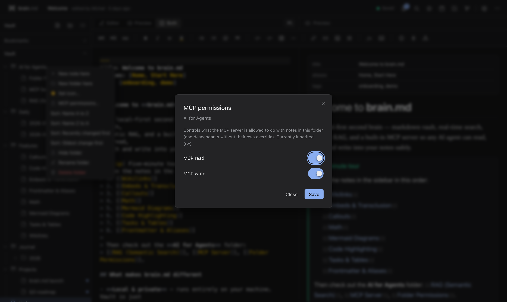

This is how you keep `Journal/Private/` out of agent reach without
locking down the whole vault.

### Optional password auth

Default: no auth. Set a password in **Settings → Security** to switch
on bearer-token authentication for *both* the HTTP API and the MCP
endpoints. Password is hashed with **argon2id** (Bun's built-in
`Bun.password`, no native crypto build needed); tokens live in memory
with a 24-hour TTL. Log out from the toolbar or from **Settings →
Security**, which also shows who is signed in.

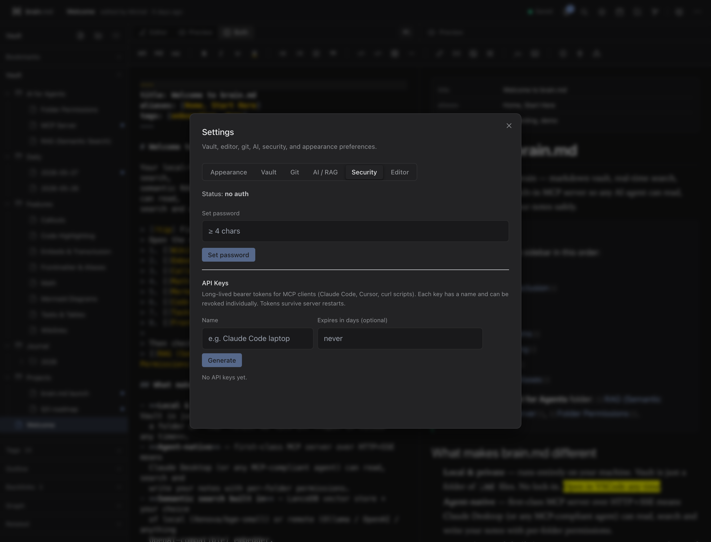

#### MCP config when auth is enabled

The plain-text MCP example earlier in the README assumes no auth.
When you turn auth on, every request to `/mcp` needs an
`Authorization: Bearer <token>` header. Most MCP clients have a
field for it:

**Claude Code / Cursor / Continue / any streamable-HTTP client**:

```json
{
  "mcpServers": {
    "brain.md": {
      "type": "streamable-http",
      "url": "https://brainmd.example.com/mcp",
      "headers": {
        "Authorization": "Bearer YOUR_TOKEN_HERE"
      }
    }
  }
}
```

**Claude Desktop (stdio-only, needs the `mcp-remote` bridge)**:

```json
{
  "mcpServers": {
    "brain.md": {
      "command": "npx",
      "args": [
        "mcp-remote",
        "https://brainmd.example.com/mcp",
        "--header",
        "Authorization: Bearer YOUR_TOKEN_HERE"
      ]
    }
  }
}
```

**How to get a token.** brain.md issues tokens through
`POST /api/auth/login`. You can do it from anywhere; a quick `curl`
is the easiest way:

```sh
curl -X POST https://brainmd.example.com/api/auth/login \
  -H 'content-type: application/json' \
  -d '{"password":"YOUR_PASSWORD"}' | jq -r .token
```

Paste the returned token into the `headers.Authorization` field
above, restart the MCP client, done.

> **Heads-up.** Tokens have a 24-hour TTL and are persisted to
> `<VAULT>/.brain/tokens.json` (only the SHA-256 hash, never the
> plaintext), so a server restart does not log you out. If your agent
> ever sees `401 Unauthorized`, the token simply expired: get a fresh
> one. Long-term: let your agent re-login on 401 instead of hardcoding
> a token (most MCP clients don't do this yet, patches welcome).

If you're embedding the URL itself anywhere persistent, prefer a
secret-manager / `.env` over hard-coding the bearer string.

#### OAuth 2.1 for Claude.ai web Custom Connectors (v0.4+)

Static bearer tokens are rejected by Claude.ai's Custom Connector
spec (MCP authorization spec 2025-11-25 forbids `?token=` in the URL
and Claude.ai's UI has no field for a static `Authorization` header).
You need full OAuth 2.1 with PKCE and Dynamic Client Registration.

brain.md ships all of it as of **v0.4.0**. Set a vault password in
Settings → Security (this is what gates the consent screen), then
in the Claude.ai Custom Connector dialog:

| Field | Value |
|---|---|
| Name | `brain.md` (or anything you like) |
| Remote MCP server URL | `https://your-brainmd.example.com/mcp` |
| OAuth Client ID | leave empty, DCR mints one |
| OAuth Client Secret | leave empty, PKCE-only public clients need none |

Claude.ai will:
1. Hit `GET /.well-known/oauth-protected-resource` and discover the
   embedded authorization server.
2. POST `/oauth/register` to obtain a `client_id` (no human input).
3. Redirect you to `GET /oauth/authorize?...` where brain.md renders
   the consent page. **Type your vault password and click Allow.**
4. Redirect back with `?code=...`, exchange at `/oauth/token` with
   PKCE verifier, get an access token + refresh token.
5. Use the access token for `/mcp` calls. Tokens are audience-bound
   (RFC 8707): a token issued for brain.md cannot be used elsewhere.

Scopes advertised: `vault:read`, `vault:write`. Per-folder permissions
(set in the web UI) still apply on top. Scope grants the surface,
folder permissions grant the path, and the narrower of the two always
wins.

The same flow works with any spec-compliant MCP client: Cursor,
ChatGPT Apps, and future Anthropic clients. Claude Code and Claude
Desktop shipped before the spec stabilised, so they still want a
static bearer or the `mcp-remote` stdio bridge, both documented above.

### Login with Google, GitHub, Keycloak or Authentik

Password auth above is one human sharing one secret. If more than one
person needs to sign in to the web app, or you want MFA without
rolling your own, point brain.md at an identity provider instead. It
is optional and sits next to password login, not instead of it:
password login stays the default and keeps working unless you
explicitly turn it off.

Every provider is an environment variable away. Set these, restart
the server:

| Variable | Required | Notes |
|---|---|---|
| `BRAINMD_PASSWORD_LOGIN` | no | `on` (default) or `off`. Refuses to start if `off` and no provider below is configured. |
| `BRAINMD_PUBLIC_URL` | only with a provider | e.g. `https://brainmd.example.com`. Builds the redirect URI (`<public-url>/api/auth/idp/<provider>/callback`), register that exact URL with the provider. |
| `BRAINMD_OIDC_ISSUER` | for OIDC | e.g. `https://accounts.google.com`. |
| `BRAINMD_OIDC_CLIENT_ID`, `BRAINMD_OIDC_CLIENT_SECRET` | for OIDC | from the provider's console. |
| `BRAINMD_OIDC_NAME` | no | button label, e.g. `Google`, `Keycloak`. Defaults to `SSO`. |
| `BRAINMD_OIDC_SCOPES` | no | default `openid email profile`. |
| `BRAINMD_OIDC_GROUPS_CLAIM`, `BRAINMD_OIDC_ALLOWED_GROUPS` | no | e.g. claim `groups`, allowed `staff,family`. Counts as an allowlist on its own. |
| `BRAINMD_GITHUB_CLIENT_ID`, `BRAINMD_GITHUB_CLIENT_SECRET` | for GitHub | from a GitHub OAuth App. |
| `BRAINMD_OAUTH_ALLOWED_EMAILS` | see below | comma list, e.g. `me@example.com,partner@example.com`. |
| `BRAINMD_OAUTH_ALLOWED_DOMAINS` | see below | comma list, e.g. `example.com`. |

A provider with no allowlist at all (no allowed emails, domains or
OIDC groups) refuses to start, brain.md will not let in anyone who
can simply reach the login page.

**Google** (OIDC): Google Cloud Console → APIs & Services →
Credentials → Create OAuth client ID → Web application. Authorized
redirect URI: `https://brainmd.example.com/api/auth/idp/oidc/callback`.
Issuer is `https://accounts.google.com`.

```sh
BRAINMD_OIDC_ISSUER=https://accounts.google.com
BRAINMD_OIDC_CLIENT_ID=...
BRAINMD_OIDC_CLIENT_SECRET=...
BRAINMD_OIDC_NAME=Google
BRAINMD_OAUTH_ALLOWED_EMAILS=you@gmail.com
BRAINMD_PUBLIC_URL=https://brainmd.example.com
```

**GitHub**: GitHub → Settings → Developer settings → OAuth Apps →
New OAuth App. Authorization callback URL:
`https://brainmd.example.com/api/auth/idp/github/callback`.

```sh
BRAINMD_GITHUB_CLIENT_ID=...
BRAINMD_GITHUB_CLIENT_SECRET=...
BRAINMD_OAUTH_ALLOWED_EMAILS=you@example.com
BRAINMD_PUBLIC_URL=https://brainmd.example.com
```

**Keycloak / Authentik** (both OIDC): create a client (confidential,
standard flow / authorization_code), redirect URI
`https://brainmd.example.com/api/auth/idp/oidc/callback`, issuer is
the realm/application's OpenID discovery base, e.g.
`https://keycloak.example.com/realms/<realm>` or
`https://authentik.example.com/application/o/<slug>`.

```sh
BRAINMD_OIDC_ISSUER=https://keycloak.example.com/realms/home
BRAINMD_OIDC_CLIENT_ID=...
BRAINMD_OIDC_CLIENT_SECRET=...
BRAINMD_OIDC_NAME=Keycloak
BRAINMD_OIDC_GROUPS_CLAIM=groups
BRAINMD_OIDC_ALLOWED_GROUPS=staff
BRAINMD_PUBLIC_URL=https://brainmd.example.com
```

> **MFA** is the identity provider's job, not brain.md's. Turn it on
> in Google/Keycloak/Authentik/GitHub itself and every login through
> that provider inherits it.

What happens on login: brain.md redirects to the provider, validates
the ID token (OIDC) or looks up the verified primary email (GitHub),
checks it against your allowlist, then issues the exact same kind of
session token password login does. Nothing about the rest of the app
changes, per-folder MCP permissions and the owner-only admin routes
work the same regardless of which door someone came in through.

> **No per-user restriction yet.** This is single-owner auth with
> multiple doors in, not multi-user access control. Everyone who gets
> past login, password or any allowlisted OIDC/GitHub identity, is the
> same unrestricted owner: full read/write on the whole vault (including
> other people's notes) and the owner-only admin routes (folder perms,
> settings, API keys). "Adding a user" today means "adding a second
> owner". Per-identity roles (owner/editor/viewer) are planned for 0.6,
> not in 0.5.x.

### Audit trail

Every autocommit names who actually made the change, not just that
something changed. Each save window makes exactly one commit. When
every file in that window came from the same person or agent, that
identity is the git author directly: your name, an API key's name, or
an OAuth client's name. When a window mixes actors (you edit one note
while an agent writes another, in the same few seconds), the commit
is attributed to you, the owner, and carries one `Changed-by: <path>
<actor>` trailer per file, naming exactly who touched what:

```
auto: notes/plan.md, notes/log.md

Changed-by: notes/plan.md Michał
Changed-by: notes/log.md ci-bot
```

An API key or OAuth client also gets `Agent:` and `On-Behalf-Of:`
trailers on its own commits, so `git log` tells you which credential
acted and for which subject, without a separate audit log to check.

Several agents sharing one key can each send an `X-Brainmd-Agent:
<name>` header; their commits are then authored `<key>/<name>` (for
example `openclaw/sekretarz`) and kept apart in History. A web edit is
attributed to the signed-in person: the Google or GitHub account, or
`BRAINMD_OWNER_NAME` / `BRAINMD_OWNER_EMAIL` for a password login. See
[docs/mcp.md](docs/mcp.md) for the header and for `base_revision`, which
keeps agents from overwriting each other's edits.
History, diff and restore in the **History** panel read straight off
this git log, so the attribution you see there is the same one
`git blame` would give you from the terminal.

A restore commit touches only the one file you restored and names
only that path, never a blanket commit of whatever else happened to
be dirty in the vault at the time.

---

## CLI

```sh
brainmd [options]            # or: bun run start
brainmd --help               # -h
brainmd --version
brainmd --vault-dir <path>   # -v <path>
brainmd --port <n>           # -p <n>
brainmd --mcp-disabled       # skip mounting MCP at /mcp/*
```

Precedence: **CLI flag > env var > XDG default**. Unknown flag →
stderr error + exit 2.

---

## Defaults & paths

| Purpose  | Env var            | Default                                     |
|----------|--------------------|---------------------------------------------|
| Vault    | `XDG_DATA_HOME`    | `$HOME/.local/share/brain.md/vault`         |
| Settings | `XDG_CONFIG_HOME`  | `$HOME/.config/brain.md/`                   |

Same logic on macOS, Linux and Windows, no OS branching. The vault
dir is `mkdir -p`-ed on first run.

Per-vault state lives under `<VAULT>/.brain/`:

```
<VAULT>/
├── Welcome.md
├── Folder/
│   ├── Note.md
│   └── .media/
│       └── img.png
└── .brain/
    ├── index.json          # mtime-based search index
    ├── settings.json       # bookmarks, dailyDir, git autocommit, rag config
    ├── folder-meta.json    # icons, colors, per-folder MCP perms
    ├── auth.json           # argon2id hash, absent when auth is off
    ├── tokens.json         # session tokens (hashed), survives a restart
    ├── vectors.json        # embedded RAG store (vectors + metadata), git-ignored
    └── trash/<ts>/...      # recoverable deletes
```

Every env knob:

| Var                            | Default | Notes                                     |
|--------------------------------|---------|-------------------------------------------|
| `VAULT_DIR`                    | XDG     | Overridden by `--vault-dir`.              |
| `PORT`                         | `3000`  | Overridden by `--port`.                   |
| `XDG_DATA_HOME`                | none    | Base for default vault location.          |
| `XDG_CONFIG_HOME`              | none    | Base for default settings location.       |
| `GIT_AUTOCOMMIT`               | `1`     | `1` / `0`. Bootstrap default only.        |
| `GIT_AUTOCOMMIT_DEBOUNCE_MS`   | `15000` | Bootstrap default only.                   |
| `ALLOWED_HOSTS`                | none    | Comma-separated extra hostnames accepted on the Host header without a password, beyond `localhost`/`127.0.0.1`/`[::1]`. Not needed once a password is set. See [Mobile](#mobile). |
| `BRAINMD_TRUST_PROXY`          | none    | `cloudflare`, or a comma-separated list of trusted reverse-proxy IPs. Changes which header the login/OAuth-consent rate limiter trusts for the real client IP behind a tunnel or reverse proxy. Unset means forwarded headers are never trusted. See [Mobile](#mobile). |

### Backups

Git autocommit (see [Auto versioning & history](#auto-versioning--history))
versions **note content only**: files directly under the vault root and its
subfolders. `.brain/` is git-ignored entirely, so a restore from git history
alone does not bring back settings, per-folder MCP permissions, the password
hash, session tokens or the RAG index. To actually restore a working
instance, back up `.brain/` separately (a plain file copy, no git needed):

- `settings.json`, `folder-meta.json`: bookmarks, daily-note dir, git
  autocommit config, RAG config, per-folder MCP permissions.
- `auth.json`: the owner password hash. Losing it without a backup means
  resetting the password, not recovering it.
- `tokens.json`: active session tokens (hashed). Losing it just logs
  everyone out, nothing to restore.
- `vectors.json`: the embedded RAG index. Losing it only costs a
  re-embed, it rebuilds from note content on next save/search.

---

## Architecture

```
+----------------+        /api/*        +-------------------+
|  React + CM6   | <------------------> |                   |
|  web client    |                      |                   |
+----------------+                      |   Elysia (Bun)    |  +-------------+
                                        |                   |  | Vault FS    |
+----------------+   /mcp HTTP+SSE      |   - Vault         |  | .brain/     |
| Claude Desktop | <------------------> |   - VaultIndex    |--|   index     |
| (or any MCP    |                      |   - GitRepo       |  |   trash     |
|  client)       |                      |   - SettingsStore |  |   vectors   |
+----------------+                      |   - AuthStore     |  |   auth.json |
                                        |   - MCP server    |  +-------------+
                                        |   - RAG pipeline  |
                                        +-------------------+
                                                  |
                                                  v
                                        +---------------------+
                                        | Embedded RAG store  |
                                        | (pure-JS, JSON)     |
                                        | WASM ONNX / OAI emb.|
                                        +---------------------+
```

- **Runtime**: Bun
- **Backend**: Elysia + native FS + GitRepo (libgit-free shell wrapper
  with an async write mutex)
- **Frontend**: React 18 + CodeMirror 6 + unified/remark/rehype +
  highlight.js + KaTeX + mermaid (lazy) + Radix UI primitives +
  Tailwind tokens (CSS vars under the hood)
- **Vector store**: embedded pure-JS store (JSON-on-disk, brute-force
  cosine), no native binding, ships in the single binary
- **Embedder**: bundled `onnxruntime-web` (WASM) plus a hand-rolled
  BERT WordPiece tokenizer, no `onnxruntime-node`, no `sharp`, no Python
- **MCP transport**: `@modelcontextprotocol/sdk`
  `WebStandardStreamableHTTPServerTransport`
- **Auth**: `Bun.password` (argon2id, no native build)

Per-component documentation lives next to the code; see [docs/](docs/)
for the MCP reference.

---

## Roadmap

- Daily-note templates with variable interpolation
- Snippet expansion in the editor (`/` trigger)
- Hybrid search (BM25 + dense), fused via RRF
- Multi-vault support behind a single server
- Encrypted vaults (age key per vault)
- Docker image (multi-arch, < 200 MB compressed)
- Notarised macOS `.app` wrapping the binary
- Hosted read-only demo

Want to nudge one of these up the list? Open an issue or PR.

---

## Sponsor

brain.md is a solo open-source effort. If it's useful to you and you
can chip in, sponsorship pays for the time that goes into new features,
docs and review.

<p align="center">
  <a href="https://github.com/sponsors/mi4uu">
    
  </a>
</p>

> The `Sponsor ❤` button at the top of this repo and the small heart
> in the brain.md topbar (next to **About**) both lead here.

---

## Contributing

Contributions welcome, see [CONTRIBUTING.md](CONTRIBUTING.md).

---

## Star history

[](https://star-history.com/#mi4uu/brain.md&Date)

Found brain.md useful? A star helps other people running local-first
agent workflows discover it. No newsletter, no tracking, no
follow-up email, just a signal that this exists.

---

## License

**GNU Affero General Public License v3.0 or later**, see
[LICENSE](LICENSE).

brain.md is, and will stay, free / libre / open-source. The AGPL was
picked over weaker permissive licenses for two specific reasons.

It closes the SaaS loophole: if you modify brain.md and run it as a
network service for others, hosted, multi-tenant, rebranded, whatever,
you must publish your modified source under the same AGPL. Strong
copyleft for a server-side tool means the community always gets the
improvements back. It also can't be relicensed under a permissive
license downstream, so forks stay open forever. Nobody can scoop the
project, slap a new logo on it, and ship a proprietary "Pro" cut.

You're free to:

- run brain.md, personally or commercially, without limits;
- fork, modify, redistribute, even rebrand, provided your fork stays
  under the AGPL and you publish the source you're running.

You're **not** free to:

- ship a closed-source product based on brain.md;
- host a modified brain.md as a public service without publishing
  your modifications under the AGPL.

### Trademarks

The name **brain.md** and the brain.md logo are *not* covered by the
AGPL. If you fork the project, you're welcome to do almost anything
with the code, but please use your own name and your own mark for
your fork so users aren't confused about which project they're
running.

---

<div align="center">

**brain.md**: your notes, your machine, your agents.

Built by **[Michał Lipiński](https://lipinski.work/)**
&nbsp;·&nbsp; [github.com/mi4uu/brain.md](https://github.com/mi4uu/brain.md)
&nbsp;·&nbsp; [report a bug](https://github.com/mi4uu/brain.md/issues/new)

</div>
